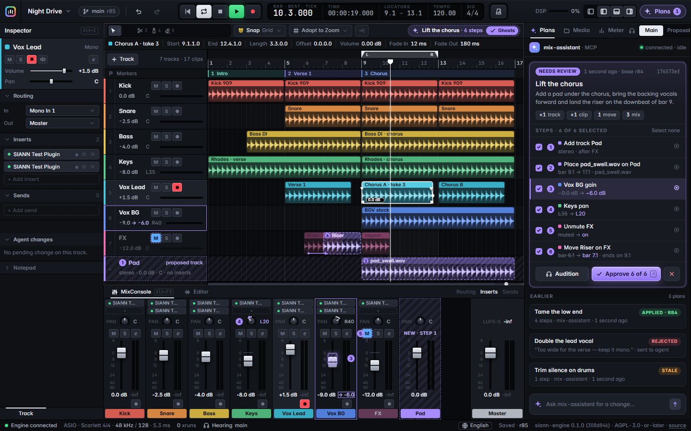
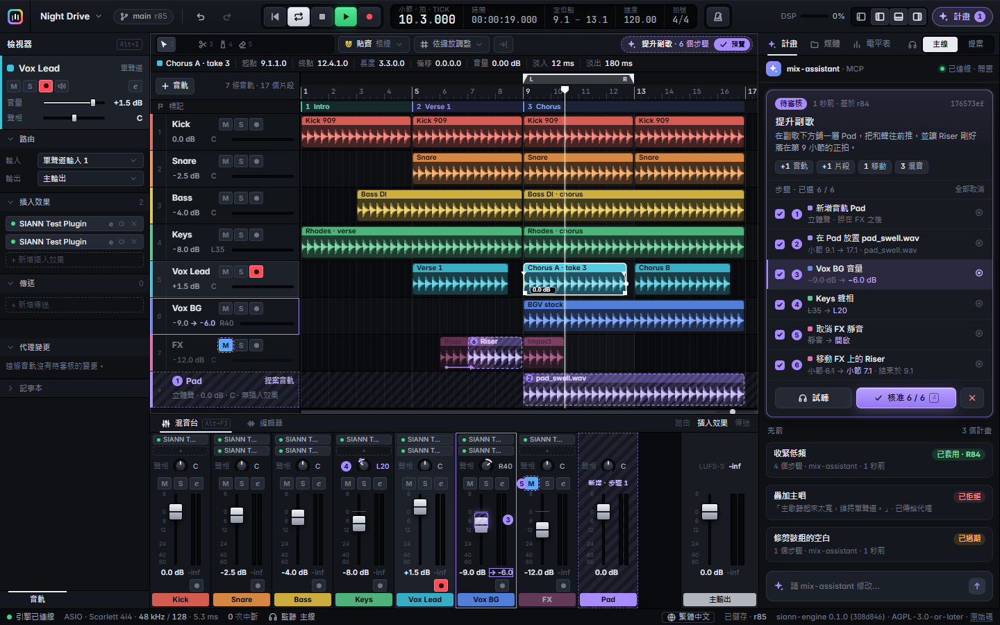
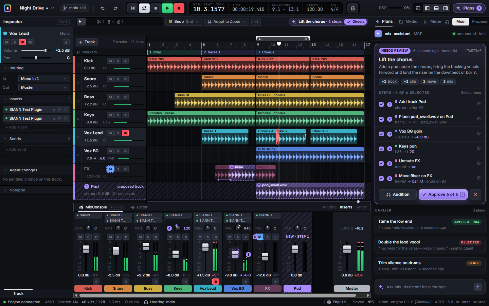
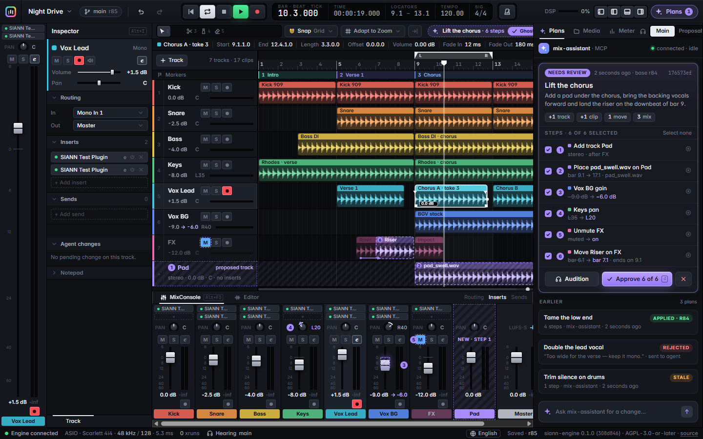
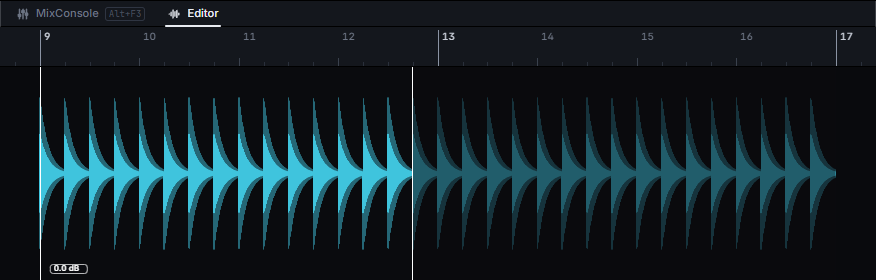

<div align="center">

# SIANN 聲

### The AI-native DAW that works like Cubase and listens like a collaborator.

**Arrange, mix and record by hand. Let an AI agent propose changes you can see, hear, approve or roll back.**

[](#-project-status)
[](LICENSE)
[](#-try-it)
[](#-what-works-today)
[](#-how-ai-fits-in)



<sub>The current build: an agent's plan "Lift the chorus" shown as violet ghosts in the event display and the MixConsole, ready to audition and approve.</sub>

</div>

> [!WARNING]
> **🚧 Under construction.** SIANN has no tagged release yet. Every build of `main` produces a Windows installer you can try, but projects, file formats and features can still change between builds. Don't use it for work you can't afford to lose yet.

---

## 🎧 Why "SIANN"?

**SIANN** is *聲* in Taiwanese Hokkien (Tâi-gí, pronounced *siann*): **sound**, and also **voice**.

That double meaning is the idea behind the project:

- **聲 as sound.** SIANN is a real digital audio workstation. It has a native audio engine, a timeline, a MixConsole and recording, made for people who make music.
- **聲 as voice.** You *say* what you want. An AI agent turns it into a plan, and you stay the one who decides. Your voice directs the session; nothing is silently rewritten.

The name is a Taiwanese word on purpose. SIANN is built in Taiwan, its interface speaks Traditional Chinese, Simplified Chinese and English from day one, and it is meant to feel at home for Mandarin-speaking producers who learned their craft on Cubase.

## ✨ Highlights

| | |
|---|---|
| 🎛️ **A DAW you already know** | Cubase's layout and default key commands: event display, MixConsole, Inspector, Channel zone, numeric keypad transport. |
| 👻 **See the AI's changes before they happen** | An agent's plan appears as violet *ghosts* on the clips, faders and knobs it would change. Nothing touches your session until you approve. |
| 🔀 **Audition A/B** | Hear the proposal against your current mix, then approve all steps, some steps, reject with a reason, or merge. |
| ↩️ **Reversible by design** | Every change is a revision. Plans are hashed and journaled, so an approved plan can't be altered and anything can be rolled back. |
| 🔌 **Real plugins** | CLAP, VST3 and AU hosting with latency compensation and crash survival. |
| 🏠 **Local-first** | Your audio, stems and lyrics stay on your machine. Agents connect over MCP and only through reviewed plans. |

## 🖼️ Screenshots

<table>
<tr>
<td width="50%"><br><sub><b>繁體中文 interface</b>: every label, menu and message in three languages.</sub></td>
<td width="50%"><br><sub><b>Recording</b>: input, arm, monitor, count-in and punch; takes land as clips.</sub></td>
</tr>
<tr>
<td width="50%"><br><sub><b>Channel zone and Inspector</b>: routing, inserts and sends for the selected track.</sub></td>
<td width="50%"><br><sub><b>Sample editor</b>: double-click a clip to trim its range and set its volume.</sub></td>
</tr>
</table>

## 🤖 How AI fits in

SIANN is closer to **Cursor for music production** than to a prompt-to-song generator. You bring the stems, loops, FX and taste. The agent helps with the detailed session work:

```text
"Lift the chorus: add a pad under it, bring the backing vocals forward,
 and land the riser on the downbeat of bar 9."
```

1. **Ask:** type the request in the Plans tab, or let a connected agent (any MCP client) propose on its own.
2. **See:** the plan's steps show as ghosts where they would land: a new track, a moved clip, a fader at its new level.
3. **Hear:** audition the proposal against your current mix (A/B).
4. **Decide:** approve all, tick only the steps you want, reject with a note the agent receives, or merge.
5. **Undo anything:** every applied plan is one revision you can roll back.

The engine is the trust boundary. Agents and the UI never edit the session directly; every change is a typed, validated command, and an agent can only reject or discard its own plans.

## 🚧 Project status

**November 2026: the "usable release" milestone is nearly finished.**

| Milestone | What it delivers | Status |
|---|---|---|
| Foundations | Native audio engine, command protocol, session documents, plans with review and rollback | ✅ Done |
| Agent access | Agents work only through reviewed plans (MCP adapter): approve, partially approve, reject, audition, roll back | ✅ Done |
| Plugins | CLAP, VST3 and AU hosting, with latency compensation and crash survival | ✅ Done, Mac compatibility pass pending |
| Desktop UI v1 | The studio window: event display, MixConsole, Inspector, Plans tab | ✅ Done, design review pending |
| **Usable release** | Open with one installer and work as a Cubase user would | 🚧 **Nearly done**, key command audit and end-to-end walkthrough next |
| Automation | Automation lanes with Write, Touch, Latch and Trim; the remaining edit tools | 📋 Planned |
| Recording production | Loop recording with takes, MIDI recording, long sessions | 📋 Planned |
| Mixing structure | Groups, VCAs, sidechain, bounce and stems, a full master channel | 📋 Planned |
| Embedded | A headless engine on an arm64 Linux board, controlled from a browser | 📋 Planned |

### ✅ What works today

<details open>
<summary><b>Projects, media and arranging</b></summary>

- A start view with New, Open, recent projects and Save; Studio Setup for the audio device and inputs.
- Drag audio in from the file manager, or use the Media tab. Track notes go in a Notepad.
- A bars-and-beats ruler with grid and snap, zoom and scroll.
- Move, copy, split, glue, trim, erase, nudge and repeat (Ctrl+D). Fades and clip volume, undo and redo.
- Markers, a cycle range saved with the project, a time signature, and a sample editor.

</details>

<details open>
<summary><b>Transport, mixing and recording</b></summary>

- Play, stop, record, cycle, click, count-in and punch. Numeric keypad commands with laptop alternatives.
- Vertical faders to +6 dB on a dB scale, pan, mute and solo, and meters with peak hold and clip lights.
- Inserts, sends and buses, a master fader with loudness, and a Channel zone for the selected track.
- Recording: choose an input, arm a track, monitor it, and record takes into clips.

</details>

<details open>
<summary><b>AI plans</b></summary>

- Proposed changes appear as ghosts in the event display, the MixConsole and the Inspector.
- A/B audition, approve all or some steps, reject with a reason, merge.
- Ask the connected agent for a change from the Plans tab.

</details>

### 🔜 Still open before the usable release

- [ ] Audit of Cubase's default key commands and the Key Commands list
- [ ] An end-to-end "Cubase user" walkthrough test and the screenshot tour in three languages
- [ ] Hands-on checks on a real audio interface, a clean Windows machine and macOS

## 🚀 Try it

**Windows installer.** Each build of the main branch produces `SIANN-Setup-<version>-x64.exe` with a `.sha256` file beside it. Check the hash, run the installer, and start SIANN from the Start menu. The installer is not code-signed yet, so Windows SmartScreen may say it "protected your PC": choose **More info**, then **Run anyway**, once you have checked the hash. Uninstall SIANN from Windows Settings, under Apps.

**From a source checkout.** With Node.js 22 or later, CMake and a C++ compiler installed (Visual Studio 2022 Build Tools on Windows):

```sh
npm run app             # installs, builds what is missing, and starts SIANN
npm run app -- --plan   # shows those steps without running them
```

The first run builds the audio engine and takes a while; later runs start straight away.

## 🧭 Product principles

- **Producer control first:** AI proposes, explains and previews; it applies only what you approve.
- **Real sessions, not disposable generations:** built for iterative work on your own material.
- **Audition everything:** every creative change is easy to hear before committing.
- **Reversible by default:** experimenting should never make a session fragile.
- **Privacy by design:** provider data flow is visible and intentional; cloud and local models both work.

## 🙌 Built for

Producers arranging songs, cues, drops and transitions · film, trailer and game audio teams with large asset packs · remixers working from stems · developers building AI-native music tools · artists who want AI help without giving up local control.


## Developer Access

This repository contains the public project materials, contributor guidance, and the first developer bridge for exploring SIANN command workflows.

```sh
git clone https://github.com/romanticamaj/siann.git
cd siann
npm test
node scripts/smoke-dawproject.js --json
```

With this repository alone, developers and agent sessions can run intake
planning, manifest generation, tests, and DAWproject export. That path does not
compile the audio engine and is the recommended first validation flow on
Windows.

The intake planner is the first agent-operable boundary: it converts recognized
audio-pack layouts into a reviewable SIANN manifest and marks unsupported loose
inputs for review before deterministic execution.

The DAWproject smoke test creates demo audio, writes a portable manifest, and
exports a Cubase-importable project exchange package with copied audio media and
timeline placement. The live import-pack command starts the local SIANN engine
runtime, creates a session, imports the manifest assets onto tracks, saves the
session, and renders a preview file. That live engine path needs the native
`siann-engine` built from `native/` in this repository (see below); the result
is a SIANN session bundle, and the DAWproject export is the way to inspect it in
another DAW.

For a review-and-approve workflow before applying changes, generate an import
plan first:

```sh
node bin/siann.js workflow import-pack examples/import-pack/manifest.json --plan /tmp/siann-import-pack-demo/plan.json --json
node bin/siann.js workflow validate-plan /tmp/siann-import-pack-demo/plan.json --json
node bin/siann.js workflow approve-plan /tmp/siann-import-pack-demo/plan.json --out /tmp/siann-import-pack-demo/approved-plan.json --approved-by "$USER" --json
node bin/siann.js workflow apply-plan /tmp/siann-import-pack-demo/approved-plan.json --out /tmp/siann-import-pack-demo/import-pack.command.json --run --json
node bin/siann.js rollback /tmp/siann-import-pack-demo/journal.json --out /tmp/siann-import-pack-demo/rollback.command.json --run --json
```

For extracted DAW test packs that follow the `_DAW/` and `_SpliceSFX/` layout,
generate a multi-track manifest first. If `_DAW/placement.md` includes in-point
and length values, they are carried into the plan as `sourceStart` and
`duration` so BGM regions are trimmed during import:

```sh
node scripts/create-daw-manifest.js /tmp/siann-user-daw-source \
  --out /tmp/siann-user-daw-multitrack-demo/manifest.json \
  --session-dir /tmp/siann-user-daw-multitrack-demo/Session \
  --preview /tmp/siann-user-daw-multitrack-demo/preview.wav \
  --journal /tmp/siann-user-daw-multitrack-demo/journal.json \
  --json
node bin/siann.js plan intake /tmp/siann-user-daw-source \
  --out /tmp/siann-user-daw-multitrack-demo/intake-plan.json \
  --json
node bin/siann.js export dawproject \
  /tmp/siann-user-daw-multitrack-demo/manifest.json \
  --out /tmp/siann-user-daw-multitrack-demo/session.dawproject \
  --copy-media \
  --json
```

Live engine commands (`run`, `--run`, `live`) start the SIANN engine,
`siann-engine`, built from `native/` in this repository. The CLI uses
`SIANN_ENGINE_EXE` when it is set, and otherwise the default build at
`native/build/dev/apps/engine/siann-engine`:

```sh
cd native
cmake --preset dev
cmake --build --preset dev --target siann-engine
```

Pass `--device fake` to run without audio hardware.

For Windows setup and Cubase DAWproject testing, see [Windows Setup](docs/setup/windows.md).

For contributor-specific architecture notes, implementation boundaries, and internal documentation links, see [AGENTS.md](AGENTS.md). For contribution workflow, see [CONTRIBUTING.md](CONTRIBUTING.md).

## License

SIANN is licensed under GPL-2.0-or-later. Contributors should assume GPL-compatible licensing requirements for engine and bridge work.

## Keywords

AI DAW, AI music production, digital audio workstation, music production copilot, local DAW, agentic music software, AI-assisted arrangement, audio production workflow, prompt-based arrangement, music AI tools.
